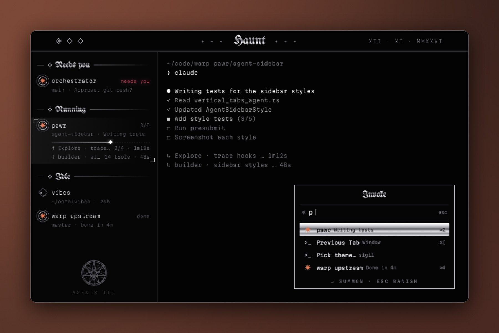

<div align="center">


# Sigilcore

**A black Haunt theme with blackletter labels and a sigil in the sidebar.**

[](https://github.com/highskore/haunt-hackathon)


[](LICENSE)



</div>

A Haunt theme in black chrome and blackletter. Titles, group labels and the palette header are set in UnifrakturMaguntia, filled with a chrome gradient. The UI is Martian Mono Light. A sigil sits at the sidebar's foot, diamonds stand for the window buttons, and a Roman-numeral date sits in the title bar. With a see-through background, a faint large sigil and corner ornaments show behind the window.

## Install and switch

Sigilcore ships with Haunt. To use this copy instead, run this from the repo:

```sh
haunt plugin install .
```

Switch to it from ⌘K ▸ Pick theme…, or set it in `~/.haunt/config.toml`:

```toml
theme = "sigil"
```

A copy you install yourself draws only the UI with its fonts, so the terminal falls back to your own monospace font. The copy bundled with Haunt uses Martian Mono for the terminal too.

## Fonts

| Font | Use | Licence |
| --- | --- | --- |
| Martian Mono | UI and terminal | SIL Open Font License 1.1, [OFL-MartianMono.txt](OFL-MartianMono.txt) |
| UnifrakturMaguntia | titles, labels, palette header | SIL Open Font License 1.1, [OFL-UnifrakturMaguntia.txt](OFL-UnifrakturMaguntia.txt) |

The theme itself is MIT ([LICENSE](LICENSE)).

## Effects

`theme.toml` turns on these `[effects]` keys. Haunt's [themes guide](https://github.com/highskore/haunt/blob/main/docs/themes.md) describes each one.

- Window: `window.square`, `window.border`, `titlebar.lights`, `lights.shape = "diamond"`, `ui.weight = "light"`
- Sidebar: `label.case`, `label.weight`, `row.select = "none"`, `progress.style = "none"`, `bar.done`, `needs.glow`, `sidebar.footer`
- Palette: `palette.inset`, `palette.header`, `palette.input.rules`, `palette.input.icon`, `palette.font`, `palette.icons`, `palette.selection = "pill"`, `palette.foot`, `palette.scrim`, `palette.keys`, `palette.tab.sub`

Its own artwork is in its `[[layer]]` tables: the second title bar rule, the group labels' diamond and rules, the selected row's glow and brackets, the icon rings and the shell's diamond, the dotted progress bar and its knob, the sigil at the sidebar's foot, and, behind a see-through terminal, the large sigil and the corner marks.

Its `[strings]` word the palette header ("Invoke"), the input glyph, the palette's hints, the sidebar's agent count in Roman numerals, the subagent prefix and the title bar's date.
